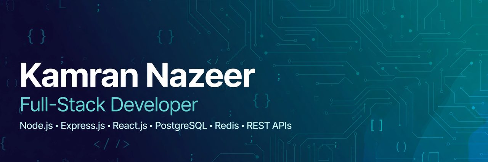

<h1 align="center">Hello, I'm <strong>Kamran Nazeer</strong> 👋</h1>

  

  

<h1>⚡ MY // DEVELOPER PROFILE</h1>

<samp>┌─ STATUS: OPEN TO WORK ───────────── STACK: FULL-STACK ─┐</samp>

  

  

  
  &nbsp;&nbsp;
  

📍 Lahore, Punjab, Pakistan &nbsp;·&nbsp; 💼 Open to Full-Stack / Backend roles &amp; freelance projects

  

## 👨‍💻 About Me

<table align="center">
  <tr>
    <td align="center">💼</td>
    <td><strong>Role</strong></td>
    <td>Associate Software Engineer @ <strong>Medsynthea</strong> — healthcare &amp; RCM software</td>
  </tr>
  <tr>
    <td align="center">🎯</td>
    <td><strong>Specialization</strong></td>
    <td>Backend development, REST API design &amp; third-party system integrations</td>
  </tr>
  <tr>
    <td align="center">🔗</td>
    <td><strong>Integrations</strong></td>
    <td>Stedi, Optum &amp; Keragon — eligibility, claims, prior authorization, EHR</td>
  </tr>
  <tr>
    <td align="center">⚙️</td>
    <td><strong>Currently Building</strong></td>
    <td>Async workflows with Redis + BullMQ — queues, retries, job tracking</td>
  </tr>
  <tr>
    <td align="center">💡</td>
    <td><strong>Passionate About</strong></td>
    <td>Clean code, edge cases, and systems that are easy to maintain as they grow</td>
  </tr>
  <tr>
    <td align="center">🤝</td>
    <td><strong>Open To</strong></td>
    <td>Full-Stack / Backend roles • Freelance projects • Collaborations</td>
  </tr>
</table>

  <strong><i>Good development is about more than making it work — it's about building things that last.</i></strong>

  

## 🛠️ Tech Stack

  
    
  

  

## 🔁 How I Work

&nbsp; ⟶ &nbsp;

&nbsp; ⟶ &nbsp;

&nbsp; ⟶ &nbsp;

&nbsp; ⟶ &nbsp;

  

`01` **DESIGN**&nbsp; `02` **BUILD**&nbsp; `03` **INTEGRATE**&nbsp; `04` **TEST**&nbsp; `05` **SHIP**

 

Plan the API → Build it clean → Connect the systems → Test the edges → Ship with confidence 🚀

  

## 💼 Services — How I Can Help You

- 🌐 **Full-Stack Web Applications** — React frontends with Node.js/Express backends
- 🔌 **REST API Development &amp; Integrations** — clean APIs, auth, third-party system integrations
- 🗄️ **Database Design** — PostgreSQL &amp; MongoDB data modelling and optimisation
- ⚙️ **Background Jobs &amp; Queues** — Redis + BullMQ async processing, retries, scheduling

  

## 📊 GitHub Stats

  
  

  

## 💼 Experience

**Associate Software Engineer — Medsynthea** · *Jun 2026 – Present* · Lahore, Pakistan
- Develop and maintain REST APIs with Node.js/Express.js for healthcare &amp; RCM workflows
- Integrate external platforms (Stedi, Optum, Keragon) for eligibility, claims &amp; prior authorization
- PostgreSQL data operations, auth/authZ with RBAC, Redis + BullMQ background jobs

## 🎓 Education

**B.S. Software Engineering (AI)** — University of Management and Technology (UMT), 2021–2025

  

## 📬 Get In Touch

  
  &nbsp;&nbsp;
  

<samp>Thanks for visiting! &nbsp;//&nbsp; Let's build something reliable together 🚀</samp>

